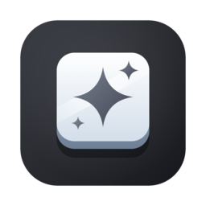

<div align="center">



# Keyboard Cleaner

**Wipe down your MacBook's keyboard and trackpad without typing, clicking, or swiping anything.**

</div>

Keyboard Cleaner covers every screen with a dimmed, see-through overlay and locks the keyboard and trackpad the moment it opens. Every key, click, scroll, trackpad gesture, and media key is swallowed system-wide, and the cursor is frozen in place. An on-screen keyboard lights up each key as you wipe it and counts how many you have covered.

To finish, hold the space bar on its own for 5 seconds. Pressing any other key during the hold restarts it, so a cloth resting across the keyboard cannot end the session by accident. The app quits once you let go of space.

## Install

You need an Apple Silicon Mac on macOS 26 or newer.

1. Download `KeyboardCleaner-v0.1.0-macos-arm64.zip` from the [latest release](https://github.com/MaxAnderson95/keyboard-cleaner/releases/latest).
2. Unzip it and drag `Keyboard Cleaner.app` into `~/Applications` or `/Applications`.
3. Open it. The app is signed ad-hoc rather than notarized, so macOS may block the first launch. If it does, go to System Settings > Privacy & Security and click **Open Anyway**.
4. Allow Accessibility access when asked (System Settings > Privacy & Security > Accessibility). Cleaning starts on its own as soon as access is on.

Each new version has a new ad-hoc signature, so macOS forgets the Accessibility grant after an update. Remove Keyboard Cleaner from the Accessibility list and add it again.

## Limits

- The Touch ID / power button is handled by hardware and still works. Pressing it can lock or sleep the Mac.
- If the app crashes or hangs, macOS removes or disables its event tap and input comes back on its own.

## Build from source

```sh
bash scripts/build-app.sh    # builds build/Keyboard Cleaner.app
bash scripts/test.sh         # runs the tests
bash scripts/make-icon.sh    # regenerates the app icon from assets/icon.svg
```

Releases are built by GitHub Actions from annotated `v*` tags.
